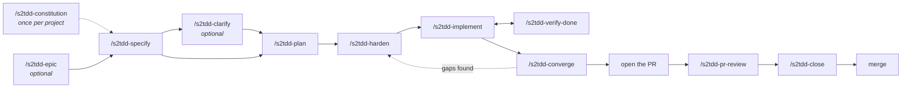

# s2tdd

**s2tdd: spec to test-driven development — a spec drives the build, and the tests it leaves are the spec that survives.**

Describe a feature. Answer hard questions about it until nothing is vague. Then let AI agents
build it test-first, overnight if you like, and come back to code where every behaviour is
pinned by a test that was written before the code was.

AI coding agents are fast and capable. Left alone, they also:

- 🌀 **drift out of scope**, and "improve" files nobody asked them to touch;
- 🩹 **rewrite the test that caught them**, so the suite goes green and the bug stays;
- 🏁 **report "done" when it isn't.**

s2tdd is a [Claude Code](https://claude.com/claude-code) plugin with a workflow built so they
can't do those things. You decide what gets built. Agents build it inside fences. A separate
check proves it before anything merges.

> **Status: early (0.4.0, in development).** The workflow has carried several features through a
> real project. It's shared as-is; see [Support](#support).

## How a feature goes

| | 1. Decide | 2. Build | 3. Prove |
|---|---|---|---|
| **Who** | You, with your strongest model | Agents, at the effort each packet needs | A fresh session that trusts nothing |
| **What happens** | The spec is drafted as Given/When/Then scenarios, and you're grilled until the design is settled. A plan and test-first, file-disjoint work packets follow | One wave at a time, a subagent per packet. A failing test comes first, then the code that passes it, then a commit | Every "done" claim is checked against the commits and a real suite run. The code is compared with the spec, and the PR is reviewed two ways |
| **Commands** | `/s2tdd-specify` → `/s2tdd-plan` → `/s2tdd-harden` | `/s2tdd-implement` | `/s2tdd-verify-done` → `/s2tdd-converge` → `/s2tdd-pr-review` → `/s2tdd-close` |
| **Your time** | Most of it goes here | None, with `--nobrakes` | A few rulings |

When the feature closes, its spec freezes for good. The tests stay behind as documentation that
can't go stale: the moment the code disagrees with them, the suite goes red. That principle,
tests as spec, is what the name hands over to: spec to TDD.

## Quick start

In Claude Code:

```text
/plugin marketplace add GnetDan/s2tdd
/plugin install s2tdd@s2tdd
```

Then, in your project:

```text
/s2tdd-specify Export the orders table as CSV, with a date-range filter
```

That's the only command you need to remember. Each step ends by telling you the next one, and
the first run sets the project up on its own. [Getting started](docs/getting-started.md) covers
setup, running without the plugin, and Cursor.

## You never have to remember what comes next: `/s2tdd-next`

Back from a break? Not sure which of thirteen commands to run? Type `/s2tdd-next`. It saves the
feature's spec files, reads them and the git history, and hands you the next step as a prompt
you can paste straight into a new session:

````text
Where things stand: 004-csv-export · waves 1–4 committed, 18/31 tasks · last commit 12 min ago
Next: /s2tdd-verify-done — waves 3–4 aren't verified yet. Fresh session; a cost-efficient model is fine.

/s2tdd-verify-done

Context:
- Wave 3 report: …
- Wave 4 report: …
````

Every other command ends by running it, so the chain carries you from idea to merge. It tells
you when to start a fresh session and when a cheaper model will do, and it lists anything that
needs your hand under **Watch out**. It never changes the project itself, never force-pushes
and never runs the suite.

## Refine the spec, then let go: `--nobrakes`

Once you've put the time into the spec and the plan, the build doesn't need you.

```text
/s2tdd-implement --nobrakes
```

One command runs every remaining wave of a hardened feature with nobody watching, then
converges until the feature is ready to close:

- 🔍 **It checks its own work.** A separate verifier agent audits each slice, and failed claims
  go to the front of the next wave.
- 👀 **Risky packets get a second reader.** A read-only reviewer reads each strong packet's diff
  before its wave is committed, and each wave's shape check reads its test packets against the
  contracts they cite.
- ⏳ **It keeps within your usage.** `week=` and `five-hour=` set its limits: the weekly one
  stops the run, the five-hour one hands off until the window resets.
- 🔁 **It carries on past trouble.** A packet that fails twice gets one more try a tier up, then
  is blocked while independent waves continue.
- 🧠 **It never runs out of context.** Before its context is half full it prints a handoff
  prompt for a fresh session, and all its state lives in files.
- 🛑 **It stops for anything that's yours to decide,** and it never merges, uses a credential or
  runs a live checkpoint. Say "brakes" and it finishes the current wave and hands back to you.

You wake up to tagged, verified slices and a run summary that says READY TO CLOSE, or why it
stopped. `--nobrakes once` stops when every task is ticked instead. [Running unattended](docs/nobrakes.md)
has the full rules: what it does for you, when it stops, and how to resume.

`--nobrakes` ran end to end in a first pilot on 0.2.0; from 0.3.0 a relay hands off by printing its prompt for you to paste, and never starts a session by itself.

## The chain, from idea to merge



| | Command | In one line |
|---|---|---|
| 📜 | `/s2tdd-constitution` | The project's principles, once per project |
| 🧭 | `/s2tdd-epic` | For work too big or unclear for one spec: decide the way first |
| 📝 | `/s2tdd-specify` | Branch, spec with ID'd scenarios, and a grilling until it's settled |
| 🔥 | `/s2tdd-clarify` | Grill an existing spec again |
| 🗺️ | `/s2tdd-plan` | The technical plan, research decisions and contracts |
| 🛡️ | `/s2tdd-harden` | Test-first tasks, split into packets an agent can't drift out of |
| ⚙️ | `/s2tdd-implement` | Build the next slice, wave by wave, red before green |
| 🔍 | `/s2tdd-verify-done` | Check every "done" claim against what was committed |
| 🎯 | `/s2tdd-converge` | Compare the code with the spec; gaps become new tasks |
| 👀 | `/s2tdd-pr-review` | Review the PR against its spec and as an outside reviewer |
| 🔒 | `/s2tdd-close` | Record what was delivered and freeze the spec |
| ⏭️ | `/s2tdd-next` | Save, see where things stand, get the next step |
| 🩺 | `/s2tdd-foundation-review` | A measured review of the whole codebase, any time |

Steps that must not be skipped can't be: implement refuses unhardened work, converge refuses
unfinished tasks, and close refuses until converge has passed after the last wave.
[The commands](docs/commands.md) says what each step does and what it leaves you with.

## Why it works

- 🧪 **Tests first, every time.** Each implementation task follows a separate task that wrote
  its failing test. No task writes a test and makes it pass.
- 🚧 **Agents stay in their lane.** Packets own disjoint files, and each one is either tests or
  implementation, never both. The orchestrator dispatches and decides; it never writes code.
- ⚖️ **A failing test is a defect, not a suggestion.** The code is wrong until the orchestrator
  cites the spec and rules otherwise. Then the test's owner rewrites it, never the implementer
  who broke it.
- ✋ **Humans decide; everything else is dispatched.** Your time goes to design answers and
  rulings. Anything a script can check, a script checks.
- 🧊 **Specs are build context, not docs.** A closed spec is never edited again. What the
  system does lives in its code and tests, so there's no second copy to fall out of date.
- 🧹 **The suite stays fast and trustworthy.** The project sets a suite-time budget, and flaky
  tests are diagnosed, never skipped or quarantined.
- 💸 **The expensive thinking happens once.** Plans are precise enough that the many build
  waves run at lower effort, whatever model the session uses, without drifting. s2tdd
  dispatches its own agent types, and every agent type runs on Opus: packets at low, medium or
  high effort by tier, the strong-diff reviewer at high and the proxy verifier at medium. See
  [Models and budget](docs/models.md).

| ✅ Use it when | ⛔ Skip it when |
|---|---|
| You want every behaviour pinned by a test | Tests are optional for your project |
| You want specs that freeze once a feature ships | You want a light, single-session flow |
| You want agents you can hand real work to | You'd rather not answer a lot of questions up front |

This is deliberately thorough and opinionated.

## Install

In Claude Code, at user scope:

```text
/plugin marketplace add GnetDan/s2tdd
/plugin install s2tdd@s2tdd
```

Updating the plugin updates the commands. Nothing else needs installing at runtime.

Where the plugin can't run, copy its `skills/` folders into the project's `.claude/skills/`.
Use the plugin or the copy, never both. Built and tested for Claude Code; Cursor is supported
best-effort. The details are in [Getting started](docs/getting-started.md).

One GitHub setting is worth turning on: automatic deletion of head branches, so merged feature
branches don't pile up on the remote.

## Documentation

| Page | What's in it |
|---|---|
| [Getting started](docs/getting-started.md) | Install, first-run setup, the specs repository, running without the plugin, Cursor, Claude desktop app extras |
| [The commands](docs/commands.md) | Each step of the chain: what happens and what you get |
| [Running unattended](docs/nobrakes.md) | `--nobrakes` in full: before you start, what it does, when it stops, how to resume |
| [Test runs](docs/test-runs.md) | One test run per wave and the full suite at slice ends: the `Per-wave tests:`, `Full suite:` and `Per-wave sees:` lines, with a pytest recipe |
| [Models and budget](docs/models.md) | Where to spend your attention, which model for which step, the agent types |
| [The workflow guide](src/pages/WORKFLOW.md) | The rules: test conventions, roles, the red-test protocol, test upkeep. Copied into each project as `specs/WORKFLOW.md` |
| [How specs live and die](src/pages/README.md) | The spec lifecycle. Copied into each project as `specs/README.md` |
| [Coming from spec-kit](docs/coming-from-spec-kit.md) | What to uninstall and which command maps to which |
| [Developing s2tdd](docs/developing.md) | What's in the repository, the build, the tests, the eval suite, releasing |
| [Changelog](CHANGELOG.md) | What changed in each version |

## Coming from spec-kit

s2tdd keeps spec-kit's `specs/NNN-name/` layout, so a spec-kit project adopts it without moving
a feature file. [Coming from spec-kit](docs/coming-from-spec-kit.md) lists what to uninstall and
which spec-kit command maps to which s2tdd command.

A project that ran the earlier preset edition of this workflow follows
[MIGRATING.md](MIGRATING.md) instead.

## Support

This is shared as-is, in the hope it's useful. Issues and pull requests are welcome, but there's
no promise of a response or a fix, and no support for agents other than Claude Code. When
something goes wrong, the commands stop with a message saying why rather than guessing, and
`/s2tdd-next` shows where the feature stands.

## Credits and license

The epic, specify and clarify commands adapt the wayfinder, grilling, domain-modeling, research
and prototype skills from [mattpocock/skills](https://github.com/mattpocock/skills). The
templates and several commands are adapted from [spec-kit](https://github.com/github/spec-kit)'s
own; each adapted file says so on the first line after its frontmatter (its first line when it
has none). Both are MIT-licensed. s2tdd is an independent project, not affiliated with
spec-kit's maintainers.

s2tdd is licensed under Apache-2.0; see [LICENSE](LICENSE), which also carries the full upstream
MIT notices.

Provided as is. I don't accept pull requests or answer issues. Fork it and make it your own.
