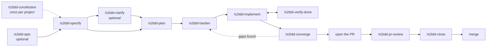

# The commands

[← Back to the README](../README.md)

Thirteen commands, eleven of them steps in a chain. You don't need to memorise the order:
every command ends by running `/s2tdd-next`, which prints the step that comes after it.

The rules behind the steps (test conventions, roles, the red-test protocol, test upkeep) are in
the [workflow guide](../src/pages/WORKFLOW.md), which s2tdd copies into each project as
`specs/WORKFLOW.md`.

## Decide

These are the steps where you shape what gets built. Use your strongest model.

### 📜 `/s2tdd-constitution`

*Once per project, then to amend.*

- **What happens:** it grills you for the project's principles one round at a time, or amends
  them with a version bump and a dated change note.
- **You get:** `specs/constitution.md`, which plan gates on.

### 🧭 `/s2tdd-epic`

*When the work is too big or unclear for one spec.*

- **What happens:** it names the destination, charts the decisions in the way, and resolves
  them one per session with you.
- **You get:** a map of decided tickets and one seed per feature spec.

### 📝 `/s2tdd-specify`

- **What happens:** it creates the `NNN-short-name` branch, drafts the spec as Given/When/Then
  scenarios with stable IDs and every open gap marked, then grills you until the design is
  settled.
- **You get:** `spec.md` with `US1-AC2`, `EC-003`, …

### 🔥 `/s2tdd-clarify`

*To grill a spec again.*

- **What happens:** more rounds, with no question cap, each question with a recommended answer
  you can accept in a word (adapted from Matt Pocock's
  [`grilling`](https://github.com/mattpocock/skills) skill).
- **You get:** every answer folded back into the spec.

### 🗺️ `/s2tdd-plan`

- **What happens:** it plans on a template that says where acceptance tests live and which
  scenarios are scripted or human checkpoints. Research decisions become R-entries.
- **You get:** `plan.md`, `research.md`, contracts and `quickstart.md`.

### 🛡️ `/s2tdd-harden`

- **What happens:** it writes `tasks.md` test-first, then splits it into file-disjoint packets
  with owners, pinned shapes and an orchestration plan.
- **You get:** every scenario mapped to a test or checkpoint, plus a ready-to-run `handoff.md`.

## Build

This step follows the hardened plan. A cost-efficient model does it just as well.

### ⚙️ `/s2tdd-implement`

- **What happens:** it orchestrates one wave at a time: a subagent per packet, red before
  green, one test run per wave ([Test runs](test-runs.md)), a commit per wave.
- **You get:** working code, with tests written first.

| Form | What it does |
|---|---|
| `/s2tdd-implement` | The next slice, then stops for you to verify |
| `/s2tdd-implement S2` (or `W4-W10`, `T031-T034`, `US5`) | A slice, waves, tasks or a story you name |
| `/s2tdd-implement --nobrakes` | Every wave left, unattended, then converge rounds until the feature is ready to close. See [Running unattended](nobrakes.md) |
| `/s2tdd-implement --nobrakes once` | Every wave left, unattended, stopping when every task is ticked |
| `/s2tdd-implement --print` | Prints the same prompt for another harness, model or window, and runs nothing |

## Prove

Nothing merges on an agent's word. A cost-efficient model is fine for verify-done and converge;
pr-review wants your strongest.

### 🔍 `/s2tdd-verify-done`

*After every implement session, in a fresh one.*

- **What happens:** it checks the "done" report against the committed waves: ticks, diff, test
  ownership and a real suite run, timed against the suite budget.
- **You get:** a claim-by-claim verdict. Tasks whose claims fail are reopened for the next
  implement session.

### 🎯 `/s2tdd-converge`

- **What happens:** it compares the code with the spec and runs the acceptance suite.
- **You get:** a clean record, or the remaining gaps as new tasks (hardened and implemented
  like the rest).

### 👀 `/s2tdd-pr-review`

*After you open the pull request.*

- **What happens:** it reviews the PR against its spec *and* as an outside code reviewer. A
  second agent tries to refute every finding.
- **You get:** a verified hitlist. Add `--fix` to fix confirmed findings test-first on the PR
  branch and post the hitlist.

### 🔒 `/s2tdd-close`

- **What happens:** it gates on a green suite and a passing converge, records what was and
  wasn't delivered and every deviation, then freezes the spec.
- **You get:** `close-out.md`; the tests become the documentation. Then you merge.

## Any time

### ⏭️ `/s2tdd-next`

It saves first: it commits and pushes the active feature's files in your specs repository, with
`constitution.md` when that is new or changed. Then it reads the feature's files and git
history, tells you in a couple of lines where things stand, and hands you the next step as a
prompt you can paste into a new session.

The prompt includes whatever the next session can't work out from the files (the wave reports
to verify, the questions you deferred, the claims that failed), and says when to start a fresh
session or switch to a cheaper model.

Under **Watch out** it lists what needs your hand:

- merged feature branches, with the commands to delete them;
- a test suite over its time budget;
- files left from spec-kit;
- a project copy of the skills shadowing the plugin.

It never changes the project itself, never force-pushes and never runs the suite.

### 🩺 `/s2tdd-foundation-review`

A measured, read-only review of the whole codebase, for when the next spec is about hardening
existing code.

## Steps that can't be skipped

| Command | Refuses when |
|---|---|
| `/s2tdd-implement` | The feature isn't hardened |
| `/s2tdd-converge` | Tasks are unfinished |
| `/s2tdd-close` | Converge hasn't passed since the last wave, or the docs wave a run built is still uncommitted |
